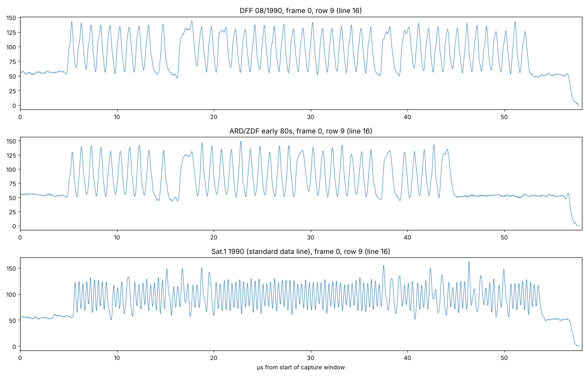
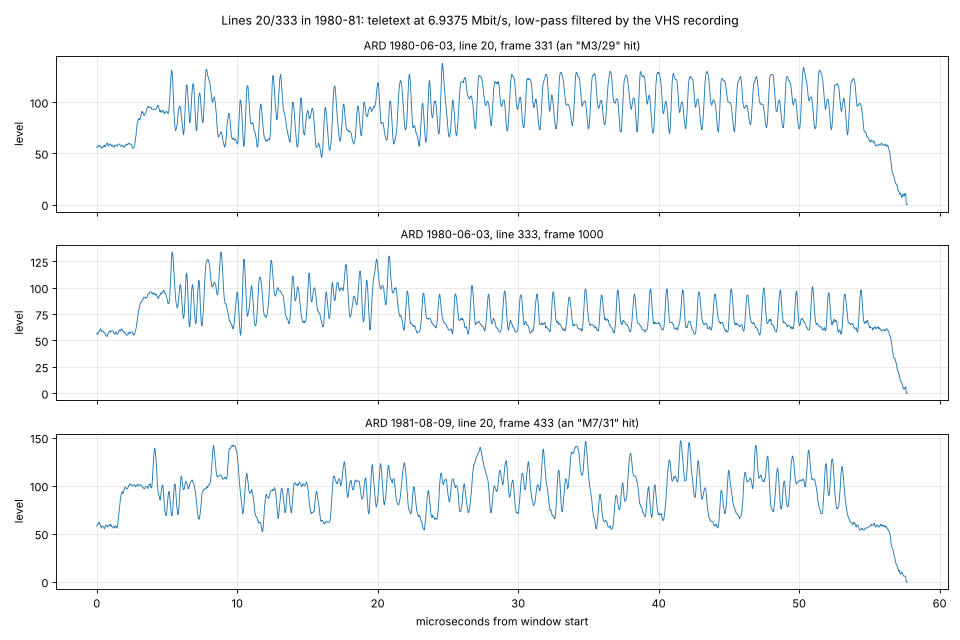
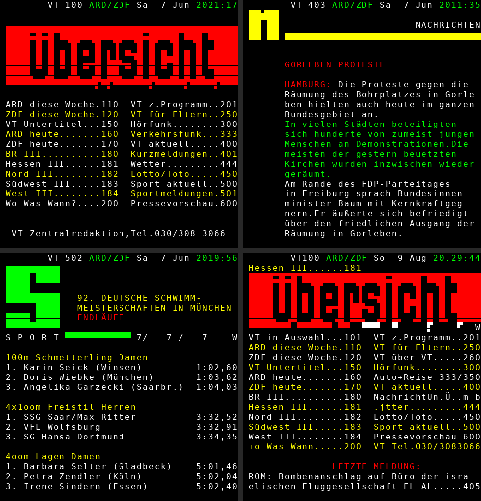
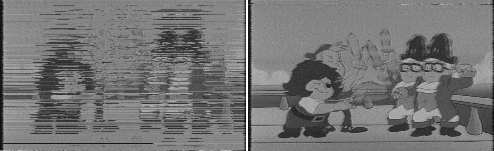

# Findings: what German TV broadcasts carried in the VBI besides teletext (1979–1998)

This document summarises an analysis of 376 raw VBI captures from VHS recordings of German TV channels between 1979 and 1998: a first batch of 110 captures (1981–1995, sections 3–9) and a second batch of 266 captures (1979–1998, section 10).
The focus is on everything that is **not** ordinary teletext meant for TV sets: the line-16/329 data lines, VPS, data channels hidden inside teletext, early packet formats, and static measurement signals.

Contents:

1. [Capture format and line numbering](#1-capture-format-and-line-numbering)
2. [Overview of findings](#2-overview-of-findings)
3. [Data line 16 (source data line) and 329 (section data line)](#3-data-line-16-source-data-line-and-line-329-section-data-line)
4. [VPS test cycle 1983–1985](#4-vps-test-cycle-19831985)
5. [The East German 1 Mbit/s data line on lines 16/329](#5-the-east-german-1-mbits-data-line-on-lines-16329)
6. [Data channels inside teletext (packet X/31)](#6-data-channels-inside-teletext-packet-x31)
7. [Early packet 8/30 and dating tapes](#7-early-packet-830-and-dating-tapes)
8. [Static measurement signals](#8-static-measurement-signals)
9. [Other unusual teletext content](#9-other-unusual-teletext-content)
10. [Collection 04: 266 further captures (1979–1998)](#10-collection-04-266-further-captures-19791998)
11. [Open questions](#11-open-questions)
12. [Sources](#12-sources)

## 1. Capture format and line numbering

- **Hardware:** the captures come from a bt848/bt878 card (Linux `bttv` driver) in raw VBI mode.
- **Sampling:** 2048 samples per line, unsigned 8 bit, at 35.46895 MHz (8 × the PAL colour subcarrier).
- **Frame layout:** 32 lines per frame (65,536 bytes):
  - rows 0–15 are TV lines 7–22 (field 1),
  - rows 16–31 are TV lines 320–335 (field 2).
- **Storage:** each capture is stored as FLAC. Decode it with:
  ```
  flac -d --force-raw-format --sign=unsigned --endian=little capture.flac
  ```
- **File names** follow the pattern `tapeNNN_MM_<channel>_<date>`. An `x` in the date means the date was unknown when the tape was digitised.

Throughout this document, "line N" means the TV line number and "row N" means the capture row.

## 2. Overview of findings

| Finding | Where | What it is |
|---|---|---|
| Plain-text source/section IDs in data word 4 of lines 16/329 | almost all tapes carrying the data line, 1985–1995 | "Source identification in plain text" (line 16, e.g. `WDR-KLN`, `SFB-SCHO`, `RIAS-TV`) and "section identification" (line 329, e.g. `DBP-FTZ` of the Deutsche Bundespost) |
| 4-bit source code in data word 3 | same | a numeric code per broadcaster (WDR 9, NDR C, ZDF 5, …) |
| VPS test cycle | ARD/ZDF 1983–1985 | a fixed 30-minute cycle of fake programme labels "11.05. 10:xx" plus the special codes, before VPS officially launched in 1985 |
| 1 Mbit/s biphase on lines 16/329 | East German DDR1/DFF (1980s and 1989–90), cable recordings 1989–90 | the data line of East German television: run-in, start code and the programme number (DDR 1 / DDR 2) |
| Data channels inside teletext (packet X/31) | ProSieben 1990 | the GIS financial data feed |
| Early-format packet 8/30 | ZDF 1984, ARD 1982/1988, BR, RIAS-TV 1990/91 | carries a header text with date and time; useful for dating tapes |
| Static measurement signals | line 328 (1982–87), line 323 (1986–91), line 323 on Sat.1/ProSieben | identical in every frame, no payload |
| Internal teletext | SFB, unknown broadcaster | `SFB/ZENTRALE 2`, `VIDEOTEXT-TESTSEITE` |

The per-tape raw summary is in [tape-overview.txt](tape-overview.txt). The decoded words of the data lines for every tape are in [data-line-words.txt](data-line-words.txt).

## 3. Data line 16 (source data line) and line 329 (section data line)

### 3.1 Background

The following comes from chapter 9.3 "Datenzeile" of the German TV history site fernsehgeschichte.de (Burosch TV Technik), which is based on a German textbook on TV transmission technology:

- **Line 16** in field 1 is the "Datenzeile" (data line), also called **"Quellendatenzeile" (source data line)**. It carries **source and control data exchanged between the broadcasters** and, in addition, the VPS information that controls home video recorders.
- **Line 329** in field 2 uses the same format and is called **"Abschnittsdatenzeile" (section data line)**. Some of the 15 data words have the same meaning in both lines, others differ.
- **Format:** 15 words of 8 bits each, in biphase code. The bit duration is 400 ns, so the data rate is 2.5 Mbit/s with a 5 MHz element clock. The signal is generated by 2-phase shift keying of a 2.5 MHz carrier, followed by a lowpass filter.
- **Data words 11–14** (32 bits) carry the VPS label: date and time of the announced programme start plus the country and programme source code.
- **Receiver chips:** a data line processor (VALVO SAA 5235) followed by a VPS decoder (VALVO SAF 1135).

In other words, **VPS is only a part of a broader inter-broadcaster data line.** The same line also carried data meant for the network, which home equipment ignored.

### 3.2 Allocation of the 15 data words, compared with what is on the tapes

The word allocation is paraphrased from table 9.1 of the source. The last column is what the 110 captures actually contain.

| Word | Line 16 (source data line) | Line 329 (section data line) | Observed on the tapes |
|---|---|---|---|
| 1 | Run-in, 1-0 element sequence for clock sync | same | decoded |
| 2 | Start code, identifies the data line and frames words 3–15 | same | decoded |
| 3 | Source identification, 4-bit code (broadcaster, post office, EBU …), bits 5–8 reserved | same | see the code table below |
| 4 | Source identification in plain text (ASCII) | Section identification in plain text | line 16: `WDR-KLN`, `NDR HMBG`, `ZDF` …; **line 329: `DBP-FTZ`, `DBP-1`, `DBP 2`** |
| 5 | Sound data (two-channel, mono, stereo, speech, music) | same | fixed per broadcaster (often `0a`). In line 329 of the post office, one bit toggles about 50:50. |
| 6 | Signal content identification, programme-related | Signal content identification, operations-related | fixed per broadcaster |
| 7 | Programme item details in plain text | Switching instructions in plain text | almost always empty (spaces or all ones). Only filler such as `99999999` (WDR), `;;;;;;;;`, `}}}}}}}}` (NDR 1992). |
| 8, 9 | Routing control | same | mostly `00`/`ff`. WDR 1986–89 `bb b2`, NDR 1986 `24 fe`, NDR 1992 `97 fa`. |
| 10 | Messages, commands | same | mostly constant; changing values in the post office's line 329 in 1986 |
| 11–14 | VPS information (label) | not used | VPS label in line 16 from 1985 on; empty (all ones) in line 329 |
| 15 | Reserved for data protection | same | mostly `00`/`ff`. **In line 329 with `DBP-FTZ` (1985/86) it carries the cycling text `Hartmann`.** |

**Bit order:** the words are transmitted LSB first. The text in words 4 and 7 is 7-bit ASCII and cycles through 8 characters, one character per frame.

**Word 3: 4-bit source code.** These values are inferred from the tapes by pairing word 3 with the plain-text name in word 4; the source does not contain a code table.

| Code (low nibble) | Source |
|---|---|
| 0 | private and cable feeds: Sat.1, RIAS-TV, Berlin cable head end, MKB, RTL |
| 1 | SWF (Südwestfunk) |
| 3 / B | Deutsche Bundespost (line 329 only) |
| 4 | BR (Bayerischer Rundfunk) |
| 5 | ZDF (`f5`; in 1985 also `05`) |
| 6 | SFB (Sender Freies Berlin) |
| 8 | HR (Hessischer Rundfunk) |
| 9 | WDR (Westdeutscher Rundfunk) |
| A | SR (Saarländischer Rundfunk); in 1983–84 also ZDF during the test phase |
| C | NDR (Norddeutscher Rundfunk) |
| E | SDR (Süddeutscher Rundfunk) |

### 3.3 Plain-text source identification (word 4, line 16)

| Tape(s) | VPS CNI | Text | Meaning |
|---|---|---|---|
| tape150_01 (1986-02-22), tape175_01, tape189_02 | DC1 | `WDR-KLN` / `WDR*KLN*` | WDR Cologne |
| tape154_02, tape166_01/02, tape175_02/03, tape181_01, tape185_01, tape187_*, tape193_02, tape195_02 | DC1 / DD4 | `NDR HMBG` | NDR Hamburg |
| tape170_01, tape180_02 | DC1 / DDB | `SFB-SCHO` | SFB Schöneberg (Berlin) |
| tape185_03 (1992) | DDB | `SFB1.REG` | SFB 1 regional |
| tape160_01, tape168_02 | DC1 | `SWF*BDN*` | SWF Baden-Baden |
| tape169_01, tape179_01 | DC1 / DCB | `BR*MCHN*`, `BR-MCHN` | BR Munich |
| tape158_01 | DC1 | `SAARL*RF` | Saarländischer Rundfunk |
| tape192_01 | DC1 | `HR*FFTM1` | HR Frankfurt |
| tape155_01 | DC1 | `BRM685/1` | unknown (BR?) |
| tape158_03, tape167_01, tape192_10, tape194_02, tape195_04 | DC1 | `WDR*ZUBR` | WDR feed line ("Zubringer") |
| tape167_02 (1995) | DC1 | `SDR*STGT` | SDR Stuttgart |
| tape192_08 | DE6 | `WDR-SAT` | WDR satellite feed |
| tape161_01, tape164_02, tape190_03, tape195_01 | DC2 | `ZDF`, `*ZDF*` | ZDF |
| tape192_02 | DB9 | `SAT1*LU1` | Sat.1 Ludwigshafen |
| tape171_01, tape192_05, tape192_09 | DB9 / DB0 | `RIAS-TV` | RIAS-TV Berlin |
| tape192_03, tape199_01 | DBF / D7F | `PK-BLN-2` | Berlin cable head end |
| tape199_02 | DC2 | `DBP-1` | Deutsche Bundespost |

### 3.4 Section data line (line 329): the post office's section

- **Who inserted it:** on ZDF recordings from 1985 to 1992, line 329 carries the section identification `DBP-FTZ` (1985–86, the Fernmeldetechnisches Zentralamt, the central telecommunications engineering office of the Deutsche Bundespost), and later `DBP-1` or `DBP 2`.
- **Interpretation:** the post office, which operated the links between studios and transmitters, inserted this line on its section of the distribution network. That matches the name "section data line".
- **Word 15:** in the `DBP-FTZ` years, the reserved word 15 carries the cycling text `Hartmann`. It is probably the name of an engineer or of the inserter's maker; this is not confirmed.

### 3.5 Other observations

- **Mislabelled tapes:** several tapes labelled "ard" carry the ZDF CNI DC2 and `ZDF` as their source text: tape150_01 (1986-02-08), tape160_02, tape164_01/02, tape165_01, tape176_01/02, tape190_01/02, tape193_01/03. They are very likely ZDF recordings.
- **tape199_01 ("br"):** it was received through the Berlin cable network (`PK-BLN-2`). The BR identification DCB appears only part of the time.

## 4. VPS test cycle 1983–1985

On tapes from 1983 to early 1985 (tape157_01, tape161_01, tape164_01/02, tape165_01, tape174_01/02, tape190_01, tape195_01), the VPS label runs through the same sequence regardless of what is on air.

Example from tape164_01, where 7,500 lines correspond to 5 minutes:

| Duration | Programme identification label (PIL) |
|---|---|
| 5 min | special code "record inhibit/terminate" (RIT, day 0, month 15, 30:63) |
| 5 min | 11.05. 10:50 |
| 2 min | 11.05. 10:55 |
| 1 min | interruption code (INT, 29:63) |
| 2 min | 11.05. 10:55 |
| 5 min | timer control code (TC, 31:63) |
| … | 11.05. 10:35, 10:40, 10:20 and 10:25 in other cycles |

During the same period, data words 6, 8 and 10 contain `aa` and words 9 and 15 contain `55`, which are alternating bit patterns.

**Interpretation (inferred, no source found):** this looks like a test sequence for VPS recorders before the official launch at the IFA trade fair in 1985. It simulates a programme scheduled for 11 May that is interrupted, continued and ended.

## 5. The East German 1 Mbit/s data line on lines 16/329

Some tapes carry a different biphase signal on lines 16 and 329. It is the data line of East German television (Fernsehen der DDR / DFF), not a West German format.



**Signal.**
- **Rate:** about 1 Mbit/s (half bit ≈ 17.7 samples, bit duration ≈ 1 µs), biphase coded.
- **Position:** it starts about 5 µs into the capture window, like the standard data line, and ends after 40 bits (older form) or 48 bits (1989–90). The 48-bit form fills almost exactly the same 48 µs as the West German 2.5 Mbit/s data line (120 bits).
- **Lines:** lines 16 and 329 carry identical content. Unlike in the West there is no separate section identification on line 329.

**Origin.**
- The only supposedly West German example, tape153_02 ("ardzdf", undated), is a 73-second excerpt of *Sekunden entscheiden*. That is the German title of the Polish series *Stawka większa niż życie*, which was shown by East German television (DFF), among other runs in 1980 and 1986 ([fernsehserien.de](https://www.fernsehserien.de/sekunden-entscheiden)). The capture has no ARD/ZDF teletext either. It is therefore an East German recording that was mislabelled.
- All other occurrences are East German as well: DDR1 1989, DFF 1 in April 1990, DFF in August 1990, and the cable recordings MKB (1989) and PK Berlin 2 (1990), which passed DFF through unchanged.
- None of the 266 captures of collection 04 (ARD/ZDF 1979–1998) carries this signal.

**Bit fields.** Read in transmission order, the bits fall into whole bytes:

| Byte | 1980s (40 bits, tape153_02) | DDR1 1989, DFF 1 04/1990, MKB | DFF 08/1990, PK Berlin |
|---|---|---|---|
| 0 | `11111111` | `11111111` | `11111111` |
| 1 | `1010 0000` | `1010 0000` | `1010 0000` |
| 2 | `00000000` | `11111111` | `11111111` |
| 3 | `11111111` | `11111111` | `11111111` |
| 4 | `0100 0000` | `1001 1111` | `0101 1111` |
| 5 | (none) | `11111111` | `11111111` |

- **Byte 0** is a run-in (`FF`), and **byte 1** (`1010 0000`) is a fixed start code in both generations.
- **The first three bits of byte 4 are the programme number (1 = DDR 1 / DFF 1, 2 = DDR 2 / DFF 2), sent LSB first.**
  - `100` (read LSB first: 1) is on both recordings labelled DDR1: tape162_01 (1989) and tape191_01 (DDR 1 / DFF 1, April 1990), on 100 % of frames for 20 minutes each.
  - `010` (2) is on the *Sekunden entscheiden* excerpt. The series ran in all its 1977, 1980 and 1986 runs on the second programme, DDR 2 ([fernsehserien.de](https://www.fernsehserien.de/sekunden-entscheiden)).
  - In recordings that switch channels the code switches with them: in the MKB cable recording (17 April 1989) it changes from `010` to `100` at about 10:10 min (frame 15261), between segments of other channels; in tape192_11 (DFF, 6 August 1990) it changes from `010` to `100` at 13.4 s (frame 334), and the DFF teletext rotating header changes at the same moment from pages 1xx to pages 3xx. tape192_04 and PK Berlin 2 (August 1990) carry `010`, so they show DFF 2.
  - This mapping is inferred from the recordings, not from a specification. The cleanest confirmation would be the picture of tape192_11 around 13 s.
  - The remaining five bits of byte 4 are `00000` in the old 40-bit form and `11111` in the 1989–90 form, like the other filler bytes.
- **Bytes 2, 3 and 5** are constant per period (`00 FF` in the 1980s, `FF FF … FF` in 1989–90). They are probably unused or reserved.
- **Bit 4 of byte 1 is a deliberate biphase code violation, i.e. a sync mark, not a data bit.** Unlike every other bit it has no transition in the middle: the soft value (first half minus second half) averages −0.02 with a spread of 0.10, against ±0.4 to ±0.8 for all other bits (tape192_04, 2,373 lines). The signal simply stays high for a whole bit period (the long plateau at about 17 µs in the plot). A biphase decoder therefore reads it as 0 or 1 at random: on line 16 and line 329 of the same frame the readings are statistically independent, and there is no correlation from frame to frame. On the cleanest recording (DDR1 1989) the reading happens to be stable.
- **No other bit ever carries information.** Across all 121,000 decoded East German lines (7 recordings), every bit except the programme number and the sync mark keeps its fixed value on more than 99.5 % of lines of the clean recordings. The only joint deviations on both lines 16 and 329 occur in a few frames around channel switches in the MKB cable recording and in the first 33 frames of tape192_11. There the bits towards the end of the line turn into runs of 0 while the tuner settles, which is a reception effect.

The exact specification (presumably by the Rundfunk- und Fernsehtechnisches Zentralamt of the Deutsche Post der DDR) was not found.

## 6. Data channels inside teletext (packet X/31)

- **tape158_02 (ProSieben 1990, "videodat"):** 35,702 packets of magazine 3, packet 31, with header `a1 02 2f`. They are spread across lines 14, 20, 21, 327, 328 and 334.
  - This is the GIS financial data feed (Independent Data Line, Format A, data channel 11).
  - It can be decoded with [gis-financefeed-vbi-decoder](https://github.com/itewreed/gis-financefeed-vbi-decoder).
  - The same tape also carries Videodat (about 2 Mbit/s NRZ) on lines 11–13 and 324–326.
- **tape168_01 (ProSieben test) and tape167_03 (RTL 1995): the "M5/31 channels" are decoding artefacts, not data channels.**
  - All of these packets (72 on ProSieben, 57 on RTL) carry exactly the same address bytes `b6 ea`. That is the GIS address `9b ea` with the first byte slipped by one bit.
  - None of them is a valid IDL Format A packet (EN 300 708): the format type and address length bytes after the address are not valid Hamming 8/4 codes in any of them, so the CRC cannot even be checked.
  - Re-framed by one or two bits ([tools/slipcheck.py](../tools/slipcheck.py)), the payload becomes readable:
    - On RTL it is ordinary teletext text from the programme pages, e.g. `18.45 RT, aktuell`, `00.25 Champions League extra`, `07.00 Punkt1w` (Punkt 12), `Kojak`.
    - On ProSieben it is text of the GIS feed, e.g. `CHEMIKAL BAnK` (Chemical Bank), `1.3725 1.3755 +.0262`, `PURES RATES`. The packet that repeats every 4 frames is most likely a slipped idle packet of the feed.
  - So the demodulator lost or gained a bit right after the framing code, and the shifted address happened to decode as magazine 5, packet 31. Neither channel exists.

## 7. Early packet 8/30 and dating tapes

On these tapes, packet 8/30 is not in the later "Format 1" (network ID plus Modified Julian Date). Instead it carries plain text with a header, page number, date and time:

| Tape | 8/30 content (majority vote) | Conclusion |
|---|---|---|
| tape174_01 (zdf 1984-01-18) | `IP 184 ARD/ZDF Mi 18.01.84` | confirms the date |
| tape159_01 (ard 1982-03-06) | `VT301 ARD/ZDF Sa 6 Mrz 23.11:41` | confirms the date (6 March 1982 was a Saturday) |
| tape155_01 (ard 1988-11-12) | `100 ARD/ZDF Sa 12.11.88 22:12:03` | confirms the date |
| tape179_01 (br 198x-11-30) | `1F2 BAYERNTEXT 30.11. 02:05:56` | no year |
| tape169_02 (rtl-tsvt 199x-06-10) | `899 TSVT Son 10 Jun 20:21` | Sunday, 10 June, so **1990** |
| tape171_01 (sat1 1992-08-04) | `TSVT 899 Son 4 Aug 15:11` | Sunday, 4 August, so **1991**, not 1992 |

The teletext page headers give further dating clues:

| Tape | Header | Likely year |
|---|---|---|
| tape151_01 (ard 198x-02-13) | `VT100 ARD/ZDF Fr 13 Feb` | 1981 (or 1987) |
| tape163_01 (ard 198x-02-20) | `VT100 ARD/ZDF Fr 20 Feb` | 1981 (or 1987) |
| tape188_02 (zdf 198x-xx-xx) | `VT100 ARD/ZDF So 21 Feb` | 21 Feb 1982 (or 1988) |
| tape182_01 (sat1 199x-01-02) | `SAT1TEXT So 2 Jan 00:5x` | 2 Jan 1994 |

The old "VTxxx ARD/ZDF" header style suggests the earlier year in each case.

## 8. Static measurement signals

**Line 328 (row 24), ARD/ZDF 1982–1987.** A fixed waveform made of fast and slow segments ([plot](images/line328_ard-zdf_1984.png)).
- It is identical in every frame except for its polarity, which flips from frame to frame (300 out of 300 samples checked).
- Data would change over time, so this is not data. The behaviour fits a test signal containing colour subcarrier: in PAL the subcarrier on a given line inverts every frame.

**Line 323 (row 19), ARD/ZDF/NDR 1986–1991.** A different waveform with the same frame-to-frame polarity flip ([plot](images/line323_zdf_1990.png)).
- The waveforms on ZDF 1990 and NDR 1988 are practically identical (correlation 0.99), so this was a network-wide signal.

**Line 323 on Sat.1/ProSieben 1990.** A line at the teletext bit rate, with run-in `55 55` but framing code `07`/`0B` instead of `27`.
- The 42-byte content is the same in every frame.
- It is probably also a test line.

**Line 332 (row 28), ARD 1988/89.** A white line containing a black pulse whose position changes ([plot](images/line332_ard_1988.png)). Its purpose is unknown. Section 10.6 shows that line 332 is mostly a property of the HD630 recording deck, so this may be a deck artefact.

**Lines 17/18 and 330/331.** These are the standard CCIR insertion test signals.
- Per the source, the test lines for 17 and 330 are inserted at the programme source ("source test line") and again at the transmitter in 18 and 331 ("section test line").
- The signals of 18 and 331 then appear in lines 19 and 332.

**VBI allocation per the source (ARD/ZDF, late 1988):**
- teletext in lines 11–15, 20, 21 and 323–328, 333, 334;
- the data line in 16 and 329;
- line 10 for a narrow pulse used to measure reflections;
- lines 22 and 335 for noise measurement.

So lines 323 and 328 were teletext lines by late 1988. On earlier tapes, and on some later ones, they carry the static polarity-flipping signals instead.

## 9. Other unusual teletext content

- **M5 X/27 on lines 14/327, ARD 1988 (tape176_01): a decoding artefact.**
  - All 226 packets with a clean address carry the same address bytes `b6 b6`. The payload alternates between `b0` and `b8`.
  - Shifted by one bit, `b0`/`b8` become `58`/`5c`. These are the characters `X` and `\` (`Ö` in the German set), which in graphics mode form a mosaic bar.
  - Rows made of exactly these characters occur on many ordinary pages of the same recording (pages 102 to 611, e.g. row 23 of page 106), on all teletext lines.
  - A row consisting of one repeated byte is periodic every 8 bits, so the demodulator can lock onto the wrong bit position. Of the 2,445 packets with this X/Ö pattern, 1,971 have an invalid address and 223 come out as "M5/27".
  - So these are normal graphics rows, not a data channel. The flickering bit is a marginal bit of the VHS recording.
- **M1 X/28 on line 328, ZDF/ARD 1985 (tape157_01, tape195_01): the static line-328 test signal, not teletext.**
  - The packets occur only on line 328, which the same captures classify as the static, polarity-flipping signal of section 8 in 54–86 % of frames.
  - Their content is the same in every frame (52 of the 106 packets on tape195_01 are byte-identical), and the block `342b2e2c d05f01fa 2f00f57f` repeats within the packet. Shifted by two bits, every byte has perfect odd parity. That is what a fixed waveform looks like when a teletext slicer reads it, not data.
  - The teletext demodulator matches this waveform in only a few frames, so the "M1/28" address is an accident. The M2 X/26 packets on line 328 in 1983 (section 10.3) are most likely the same effect.
- **X/26–X/29 on ARD, Sat.1, ZDF and RTL 1992–1995:** ordinary enhancement packets (national characters, page links, page attributes). This is regular teletext.
- **tape188_01 (unknown, possibly Sat.1):** only pages 100, 111 and 199 with the header `VIDEOTEXT-TESTSEITE` ("teletext test page"), so a test transmission.
- **tape194_01 (SFB):** the header reads `S199 SFB/ZENTRALE 2 … ARD/ZDF`. This is an internal feed of SFB's teletext centre, not a broadcast.
- **RTL 1988 (tape154_01):** teletext on many lines in both fields, but the headers are heavily corrupted. The apparent hex pages 2Cx are most likely decoding errors.

## 10. Collection 04: 266 further captures (1979–1998)

A second batch of 266 captures (about 170 GB of FLAC) was processed with the same tools.
It reaches further back (ZDF 1979, ARD 1980–81) and further forward (ARD, ZDF, HR, SWF, ProSieben, Kabel 1, RTL 1996–98, Premiere 1991).
Raw results: [tape overview](collection04/tape-overview.txt), [data-line words](collection04/data-line-words.txt), [packet 8/30](collection04/packet-830.txt).

### 10.1 The data line existed before VPS, in March 1983

The batch shows when the data line on lines 16/329 first appears.

- **No data line on any of the 30 tapes from 1982.** The first one is tape105_01 (ARD, 1983-03-15) with the source text `HR1 FFTM` (HR 1, Frankfurt am Main) on both lines 16 and 329.
- **Early plain-text sources, 1983–85.** All with the "empty" VPS label (CNI FFF):

| Tape | Date | Word 3 | Word 4 text (line 16) | Meaning |
|---|---|---|---|---|
| tape105_01 | 1983-03-15 | f8 | `HR1 FFTM` | HR 1 Frankfurt |
| tape107_02 | 1983-04-23 | 04 | `BR` (weak signal) | BR |
| tape083_01 | 1983-07-09 | e1 | ` 8 SWF  ` | SWF |
| tape106_01 | 1984-02-10 | 04 | `BR-MCHN1` | BR Munich 1 |
| tape089_01, tape142_02, tape147_01 | 1984 | 08 | `HR3 FFTM` | HR 3 (third programme) Frankfurt |
| tape051_01 | 1984-10-09 | 04 | `N3BR-MCH` | BR Munich, with "N3" |
| tape150_01 | 1984-07-29 | 9e | `SDR-TVS3` | SDR Stuttgart |

- **The 4-bit source code sits in the low nibble of word 3.** The high nibble varies (0, 8, 9, e, f), while the low nibble matches the codes found in the first batch: 1 SWF, 4 BR, 5 ZDF, 6 SFB, 8 HR, 9 WDR, A SR, C NDR, E SDR.
  - Newly confirmed in this batch: `SAARL*RF` with code A (tape165_01, 1998; tape167_01, 1994), `SDR*STGT` with code E (1990–97), `SFB*BLN1` with code 6 (1988).
  - Private broadcasters use code 0 (RTL `RTLKOELN`, Sat.1 `SAT1*LU1`, Premiere `PREMIERE`) or 3f/ff (ProSieben `PRO 7`, Kabel 1 `KABEL 1`).
- **Line 329 on ARD: `HR1 FFTM` as the section, 1983–1993.** On almost all ARD recordings line 329 carries `HR1 FFTM` with word 3 = f8, whatever regional broadcaster is named on line 16 (NDR, WDR, SFB, SDR, BR …). The recording location was evidently in the HR area, and HR inserted its own section identification. On the HR third programme (HR 3) both lines carry `HR3 FFTM`.
- **Line 329 from 1990: `DBP-1`.** HR 3 (1990, 1996–97), SWF 3 (1990), SWF (1997) and Sat.1 (1994) carry `DBP-1` on line 329 with word 3 = 03; ZDF carries `DBP-1` with word 3 = 23 (1988–1997).
- **`DBP-FTZ` with the `Hartmann` cycle in word 15** is confirmed on ZDF from December 1985 to March 1986 (word 3 = cb; c4 on one BR recording). `DBP 2` (word 3 = 0b, word 7 = 8 × 0x16) appears on ZDF in late 1986.
- **Word 7 fillers:** mostly 8 × 0x00 or 8 × 0x7F. Other fillers are 8 × 0x16 (ZDF line 329, 1986–1990), 8 × 0x10 (HR, 1985-12-23) and `99999999` (WDR 1989, NDR 1988). The last two coincide with words 9/10 = b2/76 or b2/77 instead of the usual ff/ff, so those recordings carried a routing value in words 8–10.
- **Other source texts:** `WDR*ZUBR` (WDR feed line) in 1990–91, `NDR HMBG` 1986–88, `****BR**` with word 3 = ff (1986), and `*B***S**` with word 3 = 81 (ARD 1993, unexplained).

### 10.2 The VPS test cycle on more tapes, 1983–85

The test cycle ("11.05. 10:xx" plus the special codes in 5-minute blocks) appears on 23 more tapes, from 1983-08-13 (tape131_03) to 1985-03-09 (tape148_01).

- Until 1984 word 3 is 0a (code A) with the text `ZDF`; words 6/8/10 are aa and words 9/15 are 55, exactly as in the first batch.
- In March 1985 the code changes to 05 and the text to `*ZDF*` (tape148_01, tape148_04).
- **tape136_02 (1984-01-01)** runs the same cycle with CNI DC1 (ARD), word 3 = 06 and the text `ARD-ZDF`. **tape148_05 (1984-07-28)** also shows the cycle with CNI DC1.
- In this batch the first real programme labels appear in December 1985 (there are no tapes from April to November 1985) (tape154_02 HR `23.12. 14:20`, tape154_01 ZDF `26.12. 20:15`).

### 10.3 Teletext in 1980–81: pre-standard packets

45 tapes from 1980 and 36 from 1981 cover the first months of the ARD/ZDF Videotext trial.

- **Packet 8/30 with date and time from June 1980.** tape029_01 shows `VT 180 ARD/ZDF Sa 7 Jun 20:14`, and tape079_02 shows `VT110 ARD/ZDF Fr 11 Jul 23.14:28` (both weekdays match 1980).
- **"M3 X/29" (1980–81) and "M7 X/31" (1981) on lines 20 and 333 are misread Videotext.** The raw waveform (tape005_01, tape029_01, tape047_01, frames 0–5999) shows teletext-shaped data on lines 20, 21, 329, 333 and 334 (1981: 20, 21, 333, 334; on tape029 also line 332) in 96–100% of frames: a block of about 50 µs starting 3 µs into the line, with the 6.9375 Mbit/s bits strongly low-pass filtered by the VHS recording. The run-in shows only as a raised plateau, because its 3.47 MHz fundamental is above the VHS luma bandwidth. That is why the survey slicer saw no `1010…` run-in. The long periodic stretches (one pulse every 1.15 µs, i.e. every 8 bits) are rows of spaces: 0x20 has a single 1 bit per byte. Bit errors turned them into the bytes 0x7f/0x3f. A simple adaptive slicer on these lines finds ordinary page rows (packets 0–24 in magazines 1–6) and German text fragments ("ZDF", "sich", "NAGH…"). The "M3/29" and "M7/31" addresses are therefore wrong decodes of normal Videotext rows. The fixed byte pattern of the hits comes from recurring page rows, not from a separate signal.



- **The 1980–81 Videotext pages can be recovered with an equalising slicer.** [tools/vt_equalise.py](../tools/vt_equalise.py) learns the VHS channel from the recording itself, in three steps. First a linear equaliser (41 taps at the sample rate) is trained decision-directed on bytes that pass the parity check. Then a decision-feedback equaliser with 6 feedback bits is trained the same way. Finally the feedback equaliser is refined on the page headers, whose fixed text (`VT … ARD/ZDF Sa  7 Jun 20…`) the tool learns from the majority of all headers. Each byte with bad parity gets its least reliable bit flipped, and every character of a page is voted over all repeats of that page. On the header bits, the error rate falls from about 50% with the survey slicer to 3% with the linear equaliser and 1% with the feedback equaliser (1981 tape: 1.7%). Four minutes per tape (frames 0–5999) give 65 pages (1980-06-03), 69 pages (1980-06-07) and 85 pages (1981-08-09), almost all of them complete and nearly free of errors. Examples are the index page 100 ("VT-Zentralredaktion, Tel. 030/308 3066"), news on the Gorleben eviction and the FDP party conference in Freiburg (June 1980), the results of the 92nd German swimming championships in Munich, and a "Letzte Meldung" about a bomb attack on the El Al office in Rome (August 1981). The page dumps are in [docs/videotext1980/](videotext1980/). Pages with several rotating subpages are mixed by the vote, and line 19 of 1981 carries a signal that does not decode as teletext.


- **M4 X/30 (tape071_01, 1980-09-12)** and **M8 X/30 with binary content (1982):** in 1982 the 8/30 packets of tape090_01, tape092_01, tape099_02 and tape114_01 carry no readable text, only a repeating binary structure.
- **M6 X/27 on line 20 (1982–84)** with irregular content (tape092_01, tape106_01, tape089_01), and **M2 X/26 on line 328 (tape128_01, 1983).** The latter sits on the static line-328 signal and is most likely a misreading of it (see section 9). The M6 X/27 packets are not decoded.
- **Some 1980–81 tapes have lines 20 and 333 only partly classified.** These lines carry teletext that is too weak to decode on every frame.

### 10.4 Data channels in teletext, 1996–98

- **ARD and ZDF: M8/31 is an IDL Format A keep-alive.** ZDF (tape158_02, 1996, line 324) and ARD (tape166_01, 1997, lines 7/320) both send one packet every 50 frames (2 s) in magazine 8, packet 31. Every clean packet decodes as an Independent Data Line, Format A (EN 300 708 section 6.5): FT = 0xC (continuity index and data length present), IAL = 6, service packet address `777777`, a continuity index that counts up by one per packet, data length 7, the seven bytes `TIDXX\r\n` (ZDF) or `TIXXX\r\n` (ARD), filler 0x55, and a CRC (polynomial 0x0291, from the CI byte to the end) that checks to zero. There is no other payload in 15 minutes. The channel is therefore an addressed IDL service that only sends an idle or identification message, with one letter that tells the two networks apart. Packets with a broken run-in and a non-0x55 tail are bad decodes of the same packet (the detector kept the header).
- **Kabel 1 (1998-01-25): M8/31 is filler.** The packets carry 0x20 (space) in all 40 bytes, including the byte where an IDL format type would sit (0x20 is not a valid Hamming byte). They come in bursts across many lines of the same field (for example frames 50, 99, 149, 199 on rows 17–30). These are empty packets that Kabel 1's inserter sends to fill unused VBI lines, not a data channel.
- **RTL (1998-01-03): M2/31 on line 329 carries a clock.** About five packets per second. Byte 5 (FT) = 4 (Format A with continuity index), IAL = 0 (no address), then a binary continuity index that counts up by one per second, then Hamming 8/4 nibbles: the constant `db`, a two-nibble field that changes every second (probably a check value), the constant `32`, and a 28-bit counter that also counts seconds. On this tape the counter reads 0x0B4DAF82 = 189,640,578 seconds, which is 1998-01-03 21:56:18 when counted from 1992-01-01 00:00, the recording date of the tape. The rest of the packet is Hamming zero (0x15), and there is no IDL CRC. RTL therefore sent a seconds clock (epoch 1 January 1992, time zone unknown) as a teletext data channel. What device used it is not known.
- **Regular enhancement packets:** X/26, X/28 and X/29 on ARD, ProSieben and Kabel 1 1996–98 are ordinary Level 1.5/2.5 teletext.
- **Packet 8/30 on ZDF 1996 and ProSieben 1996/98** shows a readable status text with date and time (`ARD/ZDF Mi 31.07.96 19:36:53`, `ProSieben Do 19 Feb 17:33:32`), and Kabel 1 shows `INFOTEXT`.

### 10.5 Premiere (S-VHS, labelled 1991): Nagravision Syster data decoded

Two S-VHS recordings of the pay-TV channel Premiere (65 and 69 minutes) carry a data line with the text `PREMIERE`, CNI DAC and word 3 = 00.
Lines 14, 15, 327 and 328 carry the access data of Nagravision Syster in every frame. They were decoded with the format described in hacktv (`src/syster.c`, `src/syster-ca.c`) and [tools/syster_vbi.py](../tools/syster_vbi.py). Results for the first 12,000 frames (8 minutes) of each tape are in [premiere1993/](premiere1993/).

- **Line format confirmed.** NRZ at 284 fH (4.4375 MHz, 8 capture samples per bit), 28 bytes LSB first: sync `55 D0 18 6C`, a sequence byte, 21 data bytes, CRC-16 (polynomial 0xC003). A 33-tap linear equaliser trained on the sync bytes is enough on S-VHS: 47,964 and 47,956 of 48,000 lines pass the CRC.
- **Block structure confirmed.** The sequence bytes run `73 9B 5E B6 49 A1 02 EA 15 FD`, four lines per frame, so one block of ten lines every 2.5 frames. All 4,740 and 4,768 complete blocks pass both XOR parity lines (`73`, `9B`) when the block starts at `73` as in hacktv's code (the comment in hacktv says it starts at `15`).
- **Message 1** (lines `15 FD 02 EA`): flags `0x72` throughout (scrambled, Syster, audio inversion at 12.8 kHz, key table 1), audience 0, a 7-bit ECM index `c` with a 4-bit `ap` field, eight ECM bytes, one byte that does not match hacktv's checksum guess, and a 72-byte EMM.
- **ECMs decrypt with hacktv's `premiere-ca` key `00 00 00 00 00 00 12 34`.** Even `c` carries the first ECM half, odd `c` the second; 64 pairs cycle. Every decrypted ECM has the structure hacktv expects: `00 00 07 05 | 01 01 00 00 | FF FF | date | 4 random bytes`. The random bytes form the control word (CW) for the line shuffle. The `premiere-fa` key does not give this structure.
- **The date in the ECM reads 6 March 1993 (tape 1) and 15 March 1993 (tape 2)** when decoded with hacktv's date format (`0x8666`, `0x866F`). The tapes are labelled 1991, so they are probably from March 1993 (inferred; hacktv's date format is itself reverse-engineered).
- **CW timing.** `ap` is 5 in most blocks; every 20 blocks (50 frames, 2 s) the pair `ap 1 / ap F` and 25 frames later `ap 1 / ap 0` announce the next ECM. In hacktv's model the CW is taken over at `ap 0` and the PRBS restarts every 25 frames; each PRBS step gives the shuffle parameters `s` (7 bits) and `r` (8 bits) of one field. The sample files list every CW change with the first `(s, r)` values.
- **EMMs.** Most EMMs start `00 xx yy 40` (about 2,300 to 2,500 different `xx yy` values per 8 minutes, each sent two or three times), probably addressed to individual cards. Broadcast EMMs start `00 40 00 00` like hacktv's PPUA EMM. Empty slots carry the ASCII text `DUMMY EMM` padded with `FF`, which hacktv's dummy EMM imitates.
- **Message 2** (lines `49 A1 5E B6`) differs from the later recording hacktv describes (`FE 28 B1`): byte 0 is `01`, `05`, `07`, `0B` or `7F`, byte 1 is `08`, and the EMM part is zero apart from four fixed `0x10` bytes.

What this means for scrambled recordings: with the CW sequence from the VBI and hacktv's PRBS and key table, the line order of every field can be computed. Section 10.7 confirms this on a capture of the picture of a Teleclub recording.

### 10.7 Teleclub (VHS, 25 March 1991): picture descrambled from its own VBI data

A Teleclub recording (`tape506_10_teleclub_encrypted_1991-03-25`, VHS, captured with vhs-decode as a TBC) uses the same Syster line format, block layout and ECM structure as Premiere. The ECMs decrypt with the same `premiere-ca` key and carry the date 18 March 1991. With the VBI data of the recording itself the picture of every field is put back in order ([tools/syster_descramble.py](../tools/syster_descramble.py)); left a scrambled frame, right the same frame after descrambling (luma only):



- **Slicing from the TBC.** The Syster rows are 13 and 14 of each 313-row field (lines 14/15 and 327/328), sampled at 4fsc (about 4 samples per bit). Resampled to the bttv grid, `syster_vbi.py` slices them; on this VHS capture about 55–65% of the lines pass the CRC, which is enough because every ECM is sent several times.
- **Keyless descrambling works.** For each field all 32,768 `(s, r)` pairs of hacktv's line-order model were tried; the order that gives the smallest line-to-line difference wins clearly (about 2,000 against 4,500–5,000 for the next best and the scrambled field). This alone restores the picture without any key or card, as described by Markus Kuhn in 1998.
- **hacktv's PRBS model is right.** From the `(s, r)` found on eight consecutive fields, a GF(2) solve over all 2^29 values of the second register gives exactly one solution, and the register contents at each restart are `sr2 = 0x0A0E0000` (from the constant ECM bytes `00 00 07 05`) and `sr1` = the four random ECM bytes, as in hacktv's `encrypt_syster_cw`. Between restarts the PRBS steps once per field.
- **CW timing (measured, not hacktv's guess).** Every 25 frames the block in line 14 of one frame carries an odd ECM index `c` with `ap = f` (announcement); 25 frames later the same `c` comes with `ap = 0` (takeover). Counting frames from a first field and calling the frame of the `ap = 0` block F, the PRBS restarts with the new CW at field 2F+3 and again at field 2F+53; the next takeover follows 50 frames later with `c` + 2. The restart field is one that vhs-decode flags as a second field. With this rule all 363 fields after the first restart in a 400-field excerpt descramble correctly from the VBI data alone. Premiere shows the same `ap f` / `ap 0` rhythm (section 10.5).
- **Whole tape.** 11,258 fields (3:45), scrambled from field 174 to 11,117. The VBI gave 100 CW takeovers (10 filled from the rhythm). 9,791 fields were reordered from the CWs and 1,044 by the keyless search (the start and ten gaps with an unreadable ECM); 10,764 fields end up clearly smoother than before. One scrambled field (5463, probably a dropout) stays as it was, and the clear video before and after is untouched.
- **No colour on this tape.** The scrambled part holds no colour signal: in the RF capture the 627 kHz colour-under carrier is missing there (about 200 times less energy than in the clear parts), and a burst is detectable in the chroma TBC only in the clear parts. The recording VCR switched colour off, probably with its colour killer. Neither `--no_comb` nor re-referencing the chroma to the burst of the destination line (`--chroma-mode burst`, checked on synthetic data) can change that, so this tape gives a black-and-white version only.
- **Tool.** `syster_descramble.py vbi` writes the takeover list (missing `ap 0` blocks are filled from the 50-frame rhythm), `apply` writes a descrambled `.tbcy` (and optionally `.tbcc`) with the same layout; fields without a CW can be searched keylessly with `--search`. Only the samples after the colour burst are moved, as in hacktv for PAL. The chroma part has not been checked yet.

### 10.6 Static signals and a deck artefact

- **Line 328 (row 24): already on ZDF in December 1979.** All three ZDF tapes from 1979 carry the static signal. From 1982 to 1986 it is present on many ARD/ZDF recordings. On Premiere, line 328 is Syster data (section 10.5), not this signal.
- **Line 323 (row 19):** on ZDF 1986 and on SWF 3 (1990) and SWF (1997).
- **Line 332 (row 28) is a property of the recording deck.** 98 of the 109 captures made with the HD630 deck show an unclassified signal on line 332 in 90–100% of frames. Only 5 of the 157 captures from other decks do. The line-332 observation in section 8 should therefore be treated with caution until checked against the deck used.
- **Lines 17–19 and 330–332** are unclassified on a few tapes (ARD 1989). These are the CCIR insertion test signals.

## 11. Open questions

- Which service used IDL address `777777` with the messages `TIDXX` / `TIXXX` on ZDF and ARD 1996–97, and which receiver used RTL's seconds clock on line 329?
- What do complete runs of `vt_equalise.py` over all 1980–83 tapes yield? So far only four minutes each of three tapes have been decoded.
- Does the chroma re-referencing (`--chroma-mode burst`) work on a scrambled recording that has colour on tape? The Teleclub tape has none in its scrambled part (section 10.7).
- What do the individual bits of data words 5, 6 and 8–10 mean (sound data, signal content, routing)? This needs the original ARD/ZDF/IRT specification of the data line.

Contributions and pointers to original documentation are welcome.

## 12. Sources

- fernsehgeschichte.de (Burosch TV Technik): "9. Übertragung zusätzlicher Prüf- und Datensignale", section 9.3 "Datenzeile", including table 9.1 and figure 9.1. It cites references [9, 161, 162, 163] of the underlying textbook.
- The same site, "Übertragungsverfahren für Bild, Ton und Daten". It also mentions that PALplus signalling on line 23 chose biphase code because of the good experience with data line 16.
- ETSI EN 300 231 (VPS/PDC) for the VPS label format and the special codes.
- ETSI EN 300 706 (Enhanced Teletext) and EN 300 708 (Independent Data Lines) for teletext packets 8/30, X/26–X/31.
